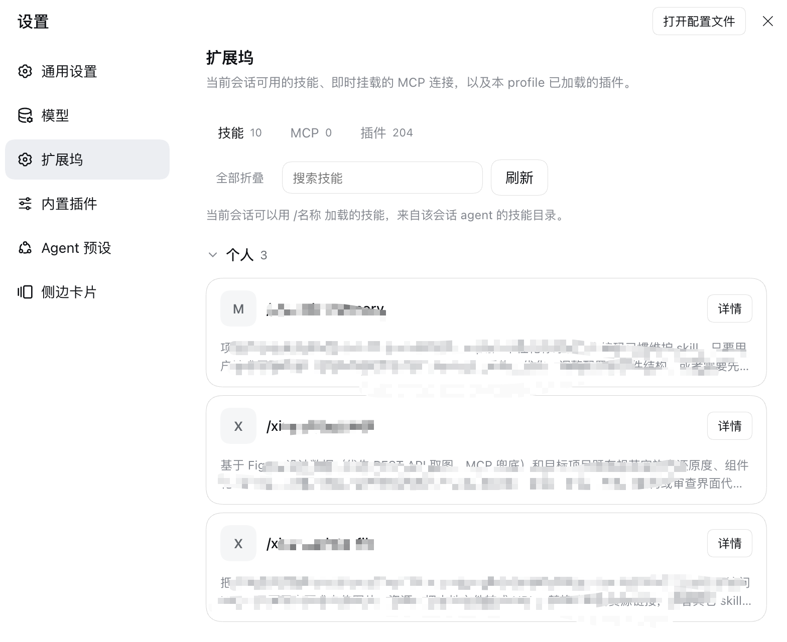

# dsh-extended-panel

[](https://github.com/tommyrunner/dsh-extended-panel/actions/workflows/ci.yml)

One DeepSeek Harness Settings section — **Extensions** — for the skills your
session can use, the MCP servers you mount, and the plugins this profile loads.
Shaped like a coding agent's plugin manager: a list first, the configuration
only after you open one row.



English | [中文](README.zh.md)

## Why this panel

**A skill list is table stakes; here you edit the skill itself.** The panel reads
`<skill dir>/agents/openai.yaml`, renders each declared parameter as the control
its `type` asks for, and writes the value back **in place**:

- **Verified writes** — after saving, the page re-reads the file and compares; it
  only reports "Saved and verified in the file" when the new values are really
  there.
- **Minimal diffs** — only the `value:` line changes. `type`, `select`, unknown
  fields, comments, and every other line stay byte-identical; the line count does
  not move; writes are idempotent and atomic (temp file + `rename`), so the
  result is reviewable in `git diff`.
- **No restart** — parameters and MCP connections apply through volatile config,
  not a plugin reload.

| Tab | List | Actions |
|---|---|---|
| **Skills** | Skills visible to the current session, grouped by source (project / personal / bundled), searchable, collapsible groups with collapse-all | **Whole card opens the detail**; the skill's parameters are editable and written back |
| **MCP** | Saved connections with a live status dot and a mount switch per row | Add in a dialog (local command or online endpoint), edit, uninstall |
| **Plugins** | The Loader entries this profile actually runs, searchable; the tail collapses past 60 rows | Read-only diagnosis |

Saving an MCP connection mounts a dedicated `@deepseek-ai/dsh-mcp-client`
immediately; its tools appear as `mcp__<name>__<tool>` with **no restart**.
Entering the section refreshes the lists, exactly like pressing Refresh.

## Skill parameters: what is supported

| `type` | Control | `value` | Written back as |
|---|---|---|---|
| `input` (default) | Text field | Any string | `value: '…'` |
| `select` | Dropdown over `select: [...]` | One of the choices | `value: '…'` |
| `boolean` | Switch | `true` / `false` | `value: true` (a YAML boolean, unquoted) |

- `select` accepts both the inline flow list (`['a', 'b']`) and the block list
  (`- a`). A current value that is no longer listed stays selectable, and an
  empty value gets an explicit empty choice — the panel never silently rewrites
  your value.
- `boolean` writes a real boolean, not the string `'true'`.
- Without `params:` (or with no parameters at all) the whole parameters section
  is not rendered — no empty title, no placeholder text.

## Skill parameters: compatibility

Both shapes are supported, so **existing files need no migration**:

```yaml
params:
  # Legacy flat scalar → text field
  LEGACY_KEY: 'value'

  # Object form: value plus UI metadata
  FIGMA_API_KEY:
    value: 'figd_…'
    type: input
  MODE:
    value: dark
    type: select
    select: ['light', 'dark']
  ENABLED:
    value: true
    type: boolean
```

- The legacy shape is read *and written* as-is — it is never silently upgraded.
- In the object shape, **unknown fields are preserved**: parsing reads only
  `value` / `type` / `select`, and writing touches only `value:`, so you can add
  your own fields today without the panel eating them.
- `value` is the value; there is no separate `default` to keep in sync.

## Skill parameters: extensibility

Adding a control type does not need an architecture change:

1. **Parse** — `type` is already carried through as an arbitrary string;
2. **Render** — add a branch in `paramRows` in `client.js` (the existing `input`
   / `select` / `boolean` branches are the template);
3. **Write** — only when the new type needs another YAML literal do you touch
   `index.js`; `patchParamsBlock` already has the “`type: boolean` → unquoted”
   rule to copy (e.g. `number` should be a bare number).

Adding a new **field** (say `placeholder`, `description`, `group`) needs no code
at all: parsing ignores it and writing leaves it alone until you choose to render
it.

## Skill parameters: making the skill obey them

The panel only **stores** values. Whether a run actually follows them depends on
whether the **skill's own `SKILL.md`** tells the agent to. Declaring `params`
without an execution rule makes the model treat them as suggestions: it asks the
user whether to change a value, offers a "recommended" alternative, or silently
overrides `value` from an environment variable.

Put this block in `SKILL.md` (rename the actions to fit your skill):

````markdown
## Parameters (strict)

Before doing anything else, read `agents/openai.yaml` in this skill's directory
and take its `params`.

- `params.<KEY>.value` is the **only** valid value: never override it with a
  hardcoded default, an environment variable, `~/.dsh/.credentials.yaml`, or a
  value from an earlier conversation.
- If a parameter exists, use it. **Do not ask the user whether to use or change
  it**, and do not suggest a different value; parameters are edited only in
  Settings → Extensions.
- With `type: select`, `value` must be one of the `select` choices; anything else
  is a configuration error.
- With `type: boolean`, treat the value as a boolean (`true` / `false`), not as a
  string.
- If a key is missing or its `value` is empty: **stop** and tell the user to fill
  it in Settings → Extensions. Do not guess, and do not offer candidates to pick
  from.
- Do not modify `agents/openai.yaml`; the panel owns that file.
- State the parameters used in your first progress line (for example
  `is_tinypng=false`, `mode=dark`), but never echo a token verbatim.
````

### Example: three parameter kinds and the matching SKILL.md rules

`agents/openai.yaml`:

```yaml
params:
  XIYA_API_TOKEN:
    value: 'eyJ…'
    type: input
  is_tinypng:
    value: false
    type: boolean
  mode:
    value: dark
    type: select
    select: ['light', 'dark']
```

The rules in `SKILL.md`:

```markdown
## Parameters

Read `params` from `agents/openai.yaml` first. The following behavior is decided
by those values and must not be changed by the agent:

- Before uploading an asset, compress it when `params.is_tinypng.value` is
  `true`; upload the original file when it is `false`. **Do not ask the user**
  whether to compress.
- Use `params.mode.value` (`light` / `dark`) for the theme. Do not guess and do
  not reuse the previous run's value.
- Authenticate only with `params.XIYA_API_TOKEN.value`; when it is missing, stop
  and tell the user to fill it in Settings → Extensions.
```

### Reading example (Python, standard library, both shapes)

```python
import pathlib
import re


def read_params(skill_dir):
    """Read params from agents/openai.yaml; flat scalars count as input."""
    text = (pathlib.Path(skill_dir) / 'agents' / 'openai.yaml').read_text(encoding='utf-8')
    lines = text.splitlines()
    start = next((i for i, line in enumerate(lines) if re.match(r'^params:\s*$', line)), None)
    if start is None:
        return {}
    params, i = {}, start + 1
    while i < len(lines):
        line = lines[i]
        if line.strip() == '':
            i += 1
            continue
        if not line.startswith((' ', '\t')):
            break
        match = re.match(r'^\s+([A-Za-z0-9_]+):\s*(.*)$', line)
        if not match:
            i += 1
            continue
        key, rest = match.group(1), match.group(2).strip()
        if rest and not rest.startswith('#'):
            params[key] = {'value': rest.strip('\'"'), 'type': 'input'}
            i += 1
            continue
        entry = {'value': '', 'type': 'input'}
        i += 1
        while i < len(lines) and (lines[i].strip() == '' or lines[i].startswith((' ', '\t'))):
            field = re.match(r'^\s+([A-Za-z0-9_]+):\s*(.*)$', lines[i])
            if field and field.group(1) in ('value', 'type'):
                entry[field.group(1)] = field.group(2).strip().strip('\'"')
            i += 1
        params[key] = entry
    return params


def require(params, key):
    """Take a required parameter; stop when it is missing instead of guessing."""
    entry = params.get(key) or {}
    value = entry.get('value', '')
    if value == '':
        raise SystemExit(f'parameter {key} is not configured; fill it in Settings → Extensions')
    return value
```

> If your project already parses YAML, `yaml.safe_load` is simpler. The only two
> rules that matter: **read only, never write**, and treat `value` as the single
> source of truth.

### Anti-patterns

- ❌ Asking "should I change it back to `true`?" when a value looks unexpected —
  parameters are configuration, not a proposal to confirm;
- ❌ Suggesting a "recommended" value and steering the user to change it;
- ❌ Overriding `value` from an environment variable, credentials, or a cached
  earlier conversation;
- ❌ Editing `agents/openai.yaml` itself (including "helpfully" syncing
  `cordis.patch.yml`);
- ❌ Continuing with a guessed default when a parameter is missing.

### Checklist

- [ ] `SKILL.md` says "read `params` from `agents/openai.yaml` before acting";
- [ ] every parameter maps to one explicit behavior branch (`true` / `false`,
  option branch, token usage);
- [ ] a missing or empty value stops the run and points at the settings panel,
  instead of asking or guessing;
- [ ] the progress line reports which parameter values were actually used.

## Install

Harness **Plugins** page → **Add plugin**, then pick one:

1. **Local directory** (best while developing — edit and refresh):
   `/absolute/path/to/dsh-extended-panel`
2. **Tarball**: the `dsh-extended-panel-1.0.0.tgz` produced by `npm pack`
3. **Git URL**: `https://github.com/tommyrunner/dsh-extended-panel.git`

Then **Enable**. Open it at **Settings → Extensions**. A change to `index.js`
(the host half) needs a re-enable or a Harness restart; a `client.js` change needs
only a page refresh.

The plugin has **no build step and no runtime dependencies**: `client.js` is a
hand-written browser module that receives React from the Harness module table,
and `index.js` resolves the Harness's own packages at runtime from the active
profile or the installation.

> Upgrading from the previous package `@local/dsh-inventory-panel`: uninstall
> that bundle first, install this one, and remove the leftover
> `- id: dsh-inventory-panel` override (with its `config`) from the profile's
> `cordis.patch.yml`.

## How it works

1. **Page** — `client.js` registers a `settings.section` and owns the header, tab
   bar, and detail views. Every control is local and uses `--dsw-alias-*` theme
   tokens, so light and dark themes follow automatically.
2. **Skills** — the session-addressed `skills/list` Remote; the panel follows the
   session the main view is using.
3. **MCP mounting** — `index.js` creates, updates, and removes Cordis Loader
   children (`dsh-extended-panel-mcp-<name>`) from `config.servers`; status is
   joined from the `pluginInventory` rows.
4. **Configuration writes** — the page mutates the plugin's own Config through
   `configForms`. `servers` and `skillParams` are `.volatile()` fields, so the
   Loader commits the new value and emits `loader/volatile-update` instead of
   restarting the plugin; the host half then re-mounts or rewrites the YAML.
5. **File reads** — `workspaceFiles/read`, which allows absolute paths outside
   the workspace and is paged by `eof` / `lines`.
6. **File writes** — host-side, limited to `*/skills/*/agents/openai.yaml`,
   atomic via temp file + `rename`.

Configuration lives in the profile's `cordis.patch.yml`:

```yaml
- id: dsh-extended-panel
  config:
    servers: []
    skillParams:
      /Users/you/.dsh/skills/demo/agents/openai.yaml:
        FIGMA_API_KEY: figd_xxx
```

## Limitations

- Skills are read-only apart from their parameters: the Harness has no per-skill
  enable switch.
- The Plugins tab is read-only; no marketplace integration (`pluginMarket`).
- The skill list needs an open session; without one it is empty with a hint.
- Only the **installed copy** is edited (the path the list shows, usually
  `~/.dsh/skills/<name>`); other copies such as `~/.codex/skills` need a manual
  sync.
- Values are stored as **plain text** in the skill file and in this profile's
  settings patch, and the panel shows them in clear.
- Dark theme uses the same tokens but has not been verified in a real render.

## Development

```bash
npm run check        # manifest, patch, locales, client module shape
npm pack --dry-run   # exactly which files an install receives
```

No `npm install` needed. See [CONTRIBUTING.md](CONTRIBUTING.md).

Release history lives in [CHANGELOG.md](CHANGELOG.md).

## License

[MIT](LICENSE)
