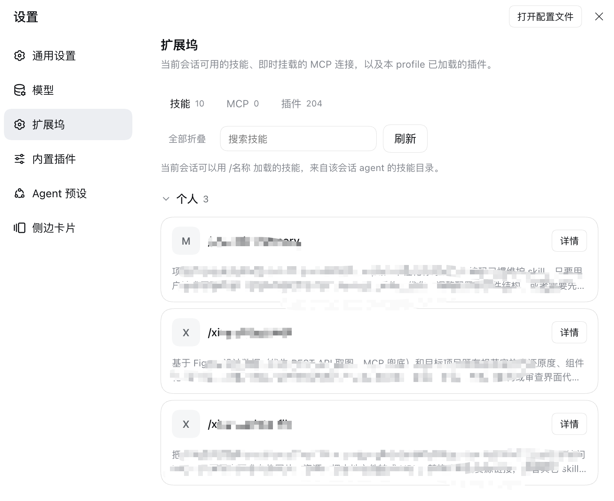

# 扩展坞 · dsh-extended-panel

[](https://github.com/tommyrunner/dsh-extended-panel/actions/workflows/ci.yml)

把 **当前会话的技能**、**MCP 连接** 和 **本 profile 已加载的插件** 收进 DeepSeek Harness 的一个设置分区「扩展坞」。形态对齐主流编码 agent 的插件管理器：**外层是列表，点某一行才进入它的详情 / 配置页**。



[English](README.md) | 中文

## 为什么用它

**技能不只是一张只读列表。** 大多数面板只能告诉你「有哪些 skill」，这里可以直接把 skill 自己的参数改掉：

- 读 `<技能目录>/agents/openai.yaml` 的 `params`，按声明的控件类型渲染成 **文本框 / 下拉框 / 开关**；
- 改完「保存参数」即**就地写回文件**，并**重读校验**——只有确认文件里真的是新值，才提示「已保存，并已在文件中确认」；
- 写回是**最小改动**：只动 `value:` 那一行，`type`、`select`、未知字段、注释、其它行一概不碰，行数不变、幂等、原子替换（临时文件 + `rename`），改完直接 `git diff` 就能看清。

| 标签 | 列表 | 能做什么 |
|---|---|---|
| **技能** | 当前会话可见的 skill，按来源分组（项目 / 个人 / 内置），搜索、分组折叠、全部折叠/展开 | 整块卡片可点进详情；**技能参数可视化配置并写回** |
| **MCP** | 已保存连接 + 实时状态圆点（已连接 / 启动中 / 失败 / 未挂载）+ 每行挂载开关 | 弹窗新增（本地命令 / 线上地址）、编辑、卸载 |
| **插件** | Loader 实际加载的插件行（条目 id、模块名、运行状态），搜索，超过 60 条折叠 | 只读排查 |

另外：MCP 连接保存后**立即挂载**为独立的 `@deepseek-ai/dsh-mcp-client`，工具马上以 `mcp__<名称>__<工具>` 出现，**不用重启**；每次进入分区自动刷新一次。

## 技能参数：支持度

`agents/openai.yaml` 里 `params` 的三种控件：

| `type` | 面板控件 | `value` 语义 | 写回形式 |
|---|---|---|---|
| `input`（默认，省略即此项） | 文本框 | 任意字符串 | `value: '…'` |
| `select` | 下拉框，选项来自 `select: [...]` | 选项之一 | `value: '…'` |
| `boolean` | 开关 | `true` / `false` | `value: true`（YAML 布尔，不加引号） |

- `select` 的列表支持**流式** `['a', 'b']` 与**块状** `- a` 两种写法；当前值不在列表里也会保留为选项，空值时给「（空）」选项，不会把用户的值悄悄改掉。
- `boolean` 的开关值写回为**真正的布尔**，不是字符串 `'true'`。
- 没有 `params:`（或一个参数都没有）时，**整个参数区不渲染**，不留空标题和空提示。

## 技能参数：兼容性

两种写法同时支持，**老文件不需要迁移**：

```yaml
params:
  # 旧：扁平标量 → 输入框
  LEGACY_KEY: 'value'

  # 新：对象形式，value 旁边带 UI 元信息
  FIGMA_API_KEY:
    value: 'figd_…'
    type: input
  MODE:
    value: dark
    type: select
    select: ['light', 'dark']
  ENABLED:
    value: true
    type: boolean
```

- 扁平写法照读照写（保持原形状，不会被强行改成对象）；
- 对象形式里**不认识的字段原样保留**（解析只取 `value` / `type` / `select`，写回只碰 `value:`）——所以你现在就能在文件里加自己的字段，面板不会吃掉；
- `value` 就是实际值，没有单独的 `default` 概念，语义简单。

## 技能参数：扩展度

加新控件类型不需要动架构，三步：

1. **解析**：`type` 已经是任意字符串，`parseParamsBlock` 原样带出；
2. **渲染**：在 `client.js` 的 `paramRows` 里加一个分支（现有 `input` / `select` / `boolean` 就是三个分支）；
3. **写回字面量**：只有当新类型需要不同 YAML 字面量时才要改 `index.js`——`patchParamsBlock` 里已有「`type: boolean` → 不加引号」的判据，照它加一条即可（例如 `number` 需要裸数字）。

加新**字段**（如 `placeholder`、`description`、`group`）甚至不用改代码：解析会忽略它，写回不会碰它；之后想用，再在渲染处读出来即可。

## 安装

插件页 → **添加插件**，三选一：

1. **本地目录**（开发最方便，改完刷新页面）：`/absolute/path/to/dsh-extended-panel`
2. **压缩包**：`npm pack` 产出的 `dsh-extended-panel-1.0.0.tgz`
3. **Git 地址**：`https://github.com/tommyrunner/dsh-extended-panel.git`

安装后 **立即启用**；打开位置：**设置 → 扩展坞**。改动 `index.js`（Host 半）需要重新启用或重启 Harness，只改 `client.js` 刷新页面即可。

插件**无构建步骤、无运行时依赖**：`client.js` 是手写的浏览器模块（React 由 Harness 模块表提供），`index.js` 运行时从当前 profile / 安装目录解析 Harness 自带包。

> 从旧包 `@local/dsh-inventory-panel` 升级：先卸载旧 bundle，再装本包，并删掉 profile `cordis.patch.yml` 里残留的 `- id: dsh-inventory-panel` 覆盖块（连 `config`）。

## 实现原理

1. **页面**：`client.js` 注册 `settings.section`，自管标题、标签栏、详情视图；控件全部本地实现，只用 `--dsw-alias-*` 主题变量（随明暗主题）。
2. **技能**：`skills/list` Remote（会话级），面板自动跟随主视图正在使用的会话。
3. **MCP 挂载**：`index.js` 按 `config.servers` 用 Cordis Loader 创建 / 更新 / 移除子条目（`dsh-extended-panel-mcp-<名称>`），状态从 `pluginInventory` 对应行读。
4. **配置写入**：页面用 `configForms` 原子写本插件 Config；`servers` 与 `skillParams` 是 `.volatile()` 字段，Loader 只提交新值并触发 `loader/volatile-update`，Host 半据此重建挂载 / 写回 YAML，**不重启插件**。
5. **读文件**：`workspaceFiles/read` Remote（允许工作区外绝对路径，按 `eof` / `lines` 分页读完）。
6. **写文件**：Host 半只接受 `*/skills/*/agents/openai.yaml`，先写临时文件再 `rename`。

配置持久化在 profile 的 `cordis.patch.yml`：

```yaml
- id: dsh-extended-panel
  config:
    servers: []
    skillParams:
      /Users/you/.dsh/skills/demo/agents/openai.yaml:
        FIGMA_API_KEY: figd_xxx
```

## 已知限制

- 技能除参数外**只读**：DSH 没有 per-skill 启停 API。
- 「插件」标签只读；未接市场（`pluginMarket`）。
- 技能列表依赖一个已打开的会话，没有会话时为空并给出提示。
- 只改**当前生效的那一份**技能（技能列表里显示的路径，通常是 `~/.dsh/skills/<name>`）；`~/.codex/skills` 等副本需手动同步。
- 值以**明文**同时存在于技能文件与本 profile 的设置补丁，页面也明文显示。
- 暗色主题使用同一批 token，但未在真实渲染中逐项确认。

## 开发

```bash
npm run check        # 清单 / patch / locale / 客户端模块形状
npm pack --dry-run   # 安装时会收到哪些文件
```

无需 `npm install`。细节见 [CONTRIBUTING.md](CONTRIBUTING.md)。

## License

[MIT](LICENSE)
